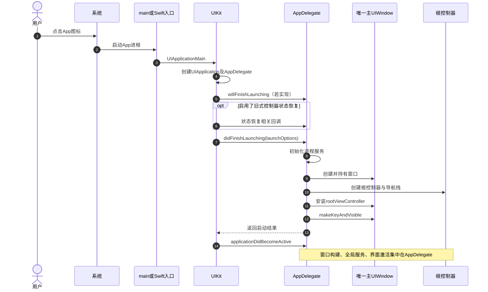
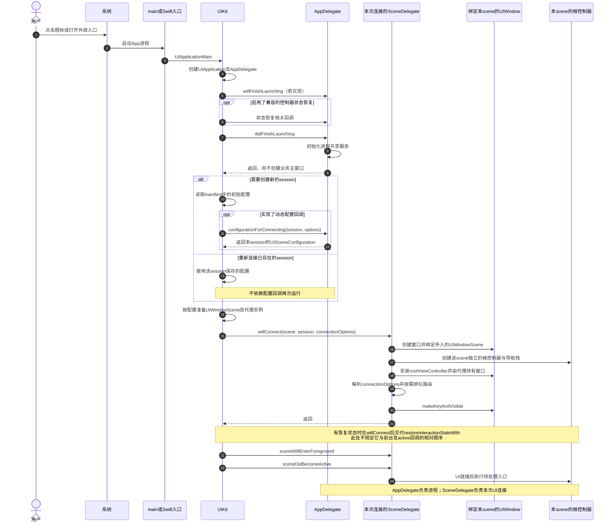
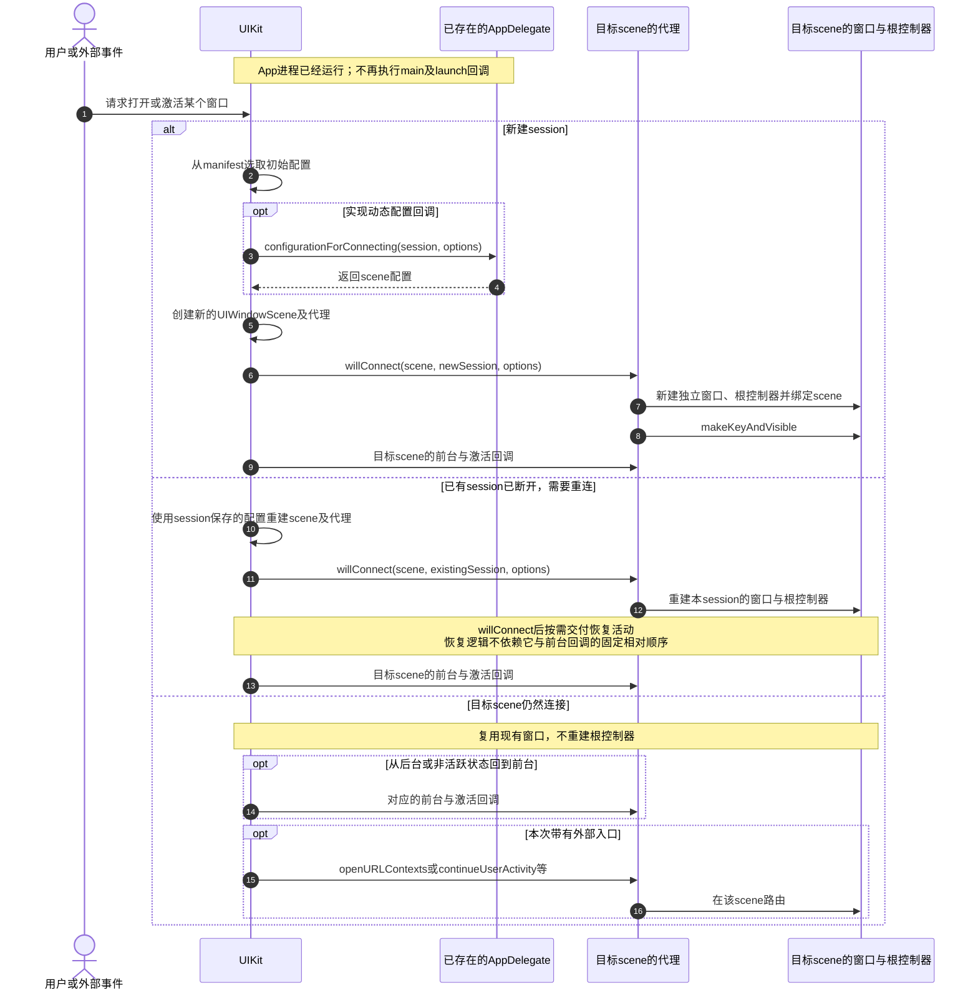

---

## 🔥 <span id="前言">前言</span>

**资料核对日期：2026-10-15。** 本文面向 [**Objective-C**](https://developer.apple.com/library/archive/documentation/Cocoa/Conceptual/ProgrammingWithObjectiveC/Introduction/Introduction.html) 新旧工程、<u>[**Swift**](https://www.swift.org/)</u> / [**UIKit**](https://developer.apple.com/documentation/uikit) 工程，说明为什么必须迁移、启动流程具体改变了什么、代码该放在哪里，以及如何验收。

从 [**iOS**](https://developer.apple.com/ios/) / [**iPadOS**](https://developer.apple.com/ipados/) 27 起，**使用最新 SDK 构建的 UIKit App 必须采用 scene 生命周期，否则无法启动。**“用 Xcode 27 编译就一定在所有系统上崩溃”不够准确：需要分清构建所链接的 SDK、运行系统，以及最低部署版本。`AppDelegate` 仍然存在；迁移的核心，是把进程初始化与每个窗口的 UI 初始化分开。[Apple 迁移文档](https://developer.apple.com/documentation/uikit/transitioning-to-the-uikit-scene-based-life-cycle)

本文用可编辑的 [**Mermaid**](https://mermaid.js.org/) 时序图重点对照**以前和今天的启动流程**。图中的回调名缩短显示，完整 OC / Swift 名称见[回调对照](#callback-map)。普通前台启动、后台唤醒、恢复已有会话是不同路径，不把所有回调画成每次必定发生。

快速入口：[强制门槛](#requirement) · [旧启动流程](#old-launch) · [新启动流程](#scene-launch) · [进程存活时的新建与重连](#warm-connection) · [配置](#manifest) · [入口事件](#entry-events) · [验收](#verification) · [工程落地记录](#implementation)

## 一、<span id="requirement">先说准确：强制的是 scene 生命周期</span> <a href="#前言" style="font-size:17px; color:green;"><b>🔼</b></a> <a href="#🔚" style="font-size:17px; color:green;"><b>🔽</b></a>

### 1.1、三个版本维度不能混用 <a href="#前言" style="font-size:17px; color:green;"><b>🔼</b></a> <a href="#🔚" style="font-size:17px; color:green;"><b>🔽</b></a>

| 维度 | 负责什么 | 与本问题的关系 |
| --- | --- | --- |
| Xcode 版本 | IDE、编译器、调试与打包工具 | Xcode 27 通常带来 iOS 27 SDK；IDE 版本名称不是完整触发条件 |
| 构建 SDK | 编译链接时采用的系统接口及链接行为 | 官方要求针对“使用最新 SDK 构建”的 App |
| 设备运行系统 | 实际执行 App 的系统 | iOS / iPadOS 27 开始执行新的启动要求 |
| 最低部署版本 | App 允许安装到的最低系统 | 降低该值不能规避新 SDK 在新系统上的启动要求 |

[**Apple**](https://www.apple.com/) 在 [WWDC25：Make your UIKit app more flexible](https://developer.apple.com/videos/play/wwdc2025/282/) 预告下一大版本的强制要求；[WWDC26：Modernize your UIKit app](https://developer.apple.com/videos/play/wwdc2026/278/) 的 2:10 章节确认，使用最新 SDK 时没有 scene 生命周期的 App 将无法启动。最终条件以当前[迁移文档](https://developer.apple.com/documentation/uikit/transitioning-to-the-uikit-scene-based-life-cycle)为准，不从“旧包在新系统上还能打开”推导“升级 SDK 后也安全”。

工程判断：不要为了绕过要求长期停留在旧 SDK，也不要把部署目标强行抬到 27 当成修复。完成 scene 迁移后，旧系统支持范围仍由业务、依赖和 API 可用性决定。

### 1.2、单窗口也必须有 scene，多窗口仍是产品选择 <a href="#前言" style="font-size:17px; color:green;"><b>🔼</b></a> <a href="#🔚" style="font-size:17px; color:green;"><b>🔽</b></a>

- `UIApplicationSupportsMultipleScenes = false`：采用 scene 生命周期，同时只显示一个 scene；这可以满足生命周期要求。
- `UIApplicationSupportsMultipleScenes = true`：允许多个 scene 同时存在；每个 scene 的窗口、导航栈、页面状态都要独立。
- 只有一个 `SceneDelegate` 文件，不代表运行时只有一个代理实例。系统为不同连接创建各自的场景及代理。

三份 Jobs 基础工程原本已经启用多 scene，并有独立 SceneDelegate Demo。因此工程修复应保留多窗口能力，修正遗漏的配置、事件与窗口归属，不通过关闭多窗口掩盖全局窗口问题。[TN3187](https://developer.apple.com/documentation/technotes/tn3187-migrating-to-the-uikit-scene-based-life-cycle)

### 1.3、旧警告与实际失败要区分 <a href="#前言" style="font-size:17px; color:green;"><b>🔼</b></a> <a href="#🔚" style="font-size:17px; color:green;"><b>🔽</b></a>

旧系统会记录“尚未采用 scene、将来会触发断言”的迁移提示；新要求生效后，问题不再只是弃用警告。出现启动断言时，先查看运行日志、最终 App 的 `Info.plist` 和实际回调，不能只检查工程目录里是否存在 `SceneDelegate` 文件。[TN3187 的版本说明](https://developer.apple.com/documentation/technotes/tn3187-migrating-to-the-uikit-scene-based-life-cycle)

## 二、<span id="launch-comparison">以前与今天：真正改变的是启动流程</span> <a href="#前言" style="font-size:17px; color:green;"><b>🔼</b></a> <a href="#🔚" style="font-size:17px; color:green;"><b>🔽</b></a>

### 2.1、<span id="old-launch">以前：AppDelegate 同时初始化进程与唯一主窗口</span> <a href="#前言" style="font-size:17px; color:green;"><b>🔼</b></a> <a href="#🔚" style="font-size:17px; color:green;"><b>🔽</b></a>

下图描述**未采用 scene 的纯代码 UIKit App，从未运行到前台可交互**的典型冷启动。它用于理解旧架构，不能再作为新 SDK 的目标实现。若旧工程采用主 storyboard，窗口和初始控制器的创建由 UIKit 承接，不能再机械套用图中的手动创建步骤。



OC 的 `main.m` 通常显式调用 `UIApplicationMain`；UIKit Swift 工程的 `@main AppDelegate` 由入口机制衔接。`@main` 本身不意味着已经使用 scene。旧架构常见的问题，是任何模块都去读取 `AppDelegate.window`，并假定整个进程只有这一套 UI。

### 2.2、<span id="scene-launch">今天：先启动进程，再连接一个窗口场景</span> <a href="#前言" style="font-size:17px; color:green;"><b>🔼</b></a> <a href="#🔚" style="font-size:17px; color:green;"><b>🔽</b></a>

下图仍是**普通前台冷启动、纯代码创建窗口**。图中“新会话”与“恢复已有会话”是替代分支：冷启动也可能恢复上次保留的 session，不能把冷启动等同于永远新建 session。



图中把 `UIWindowScene` 与代理实例的准备作为系统步骤，不规定二者内部构造的先后。业务窗口部分展示职责与依赖，不要求两种语言逐行采用完全相同的构造顺序：Swift 宿主实际先构造 root，再交给 `UIWindow.jobsMake(scene:root:)` 工厂；OC 链先创建窗口，再设置 root。两者都必须在展示前完成 scene 绑定、root 安装与窗口持有。

`makeKeyAndVisible` 只是设置窗口为可见并请求成为 key window，不等于 scene 已经 active，也不等于开屏、登录或首屏数据已经就绪。路由应由工程的 UI 就绪条件驱动，不能任意延时后猜测。

系统可以仅为后台事件启动进程，不必立刻创建可见业务窗口；这种路径不会照图走到前台 active。相关依据：[Apple 启动顺序](https://developer.apple.com/documentation/uikit/about-the-app-launch-sequence)、[响应启动](https://developer.apple.com/documentation/uikit/responding-to-the-launch-of-your-app)、[scene 连接回调](https://developer.apple.com/documentation/uikit/uiscenedelegate/scene(_:willconnectto:options:))。

### 2.3、<span id="warm-connection">进程还活着：新建窗口、重连窗口、重新激活是三条路</span> <a href="#前言" style="font-size:17px; color:green;"><b>🔼</b></a> <a href="#🔚" style="font-size:17px; color:green;"><b>🔽</b></a>



图中的前台、激活与外部事件只表示各自适用的步骤，**不承诺所有外部事件都固定在 active 之后到达**。业务层必须兼容“事件先到、UI 尚未就绪”。配置回调用于配置创建，不用来承接每次窗口激活都必须执行的业务；每次新建或恢复 UI 的连接准备放在 `willConnect`。[场景配置 API](https://developer.apple.com/documentation/uikit/uiapplicationdelegate/application(_:configurationforconnecting:options:))、[连接 API](https://developer.apple.com/documentation/uikit/uiscenedelegate/scene(_:willconnectto:options:))

### 2.4、<span id="startup-boundary">哪些只执行一次，哪些会重复</span> <a href="#前言" style="font-size:17px; color:green;"><b>🔼</b></a> <a href="#🔚" style="font-size:17px; color:green;"><b>🔽</b></a>

| 启动步骤 | 执行边界 | 应放内容 | 不应放内容 |
| --- | --- | --- | --- |
| `main` / UIKit Swift 入口 | 每次进程启动 | 交给标准入口机制 | 数据库迁移、网络请求等重工作 |
| AppDelegate `willFinish` / `didFinish` | 每次进程启动 | 共享服务、通知代理、日志与全局配置 | 创建所有窗口、重建各窗口的页面 |
| `configurationForConnecting` | 新 scene 配置选择；不是每次激活 | 根据 role、activity 选择配置 | 窗口展示、消费并丢弃冷启动路由 |
| SceneDelegate `willConnect` | 每次创建或恢复 UI 连接 | scene 绑定窗口、根控制器、收集连接入口 | 重复注册全进程服务 |
| `restoreInteractionStateWith` | 系统提供恢复状态时 | 恢复本 session 的页面交互状态 | 覆盖本次用户主动打开的目标 |
| `sceneWillEnterForeground` | 对应 scene 进入前台 | 刷新本窗口需要的数据 | 断言整个进程刚启动 |
| `sceneDidBecomeActive` | 对应 scene 获得交互状态 | 恢复动画、检查本窗口待处理路由 | 每次重建 window、root 或开屏 |

“启动一次”默认指一次进程启动，不等于 App 首次安装后的第一次运行。安装初始化需要持久标记；多窗口共享服务需要幂等初始化；UI 初始化则以本次 scene 连接为单位。[启动职责分配](https://developer.apple.com/documentation/uikit/about-the-app-launch-sequence)

## 三、<span id="responsibilities">职责拆分与完整回调对照</span> <a href="#前言" style="font-size:17px; color:green;"><b>🔼</b></a> <a href="#🔚" style="font-size:17px; color:green;"><b>🔽</b></a>

### 3.1、进程、会话、场景、窗口各管什么 <a href="#前言" style="font-size:17px; color:green;"><b>🔼</b></a> <a href="#🔚" style="font-size:17px; color:green;"><b>🔽</b></a>

| 对象 | 作用 | 保存什么 |
| --- | --- | --- |
| `UIApplication` / `AppDelegate` | App 进程与共享能力 | 通知注册、共享服务、scene 配置策略 |
| `UISceneSession` | 可持续的 UI 会话身份 | `persistentIdentifier`、配置、恢复活动 |
| `UIWindowScene` | 当前连接中的 UI 环境 | scene 状态、显示环境、本 scene 的窗口集合 |
| `SceneDelegate` | 单个 scene 的回调入口 | 本 scene 的 `window`、路由与恢复上下文 |
| `UIWindow` | 承载根控制器与视图 | 绑定的 `windowScene`、窗口级主题与层级 |

一个 session 断开后仍可能保留，后续连接时重新建立内存对象。不要拿 `SceneDelegate` 指针当永久会话身份，也不要把 `sceneDidDisconnect` 当成用户永久删除会话。[UISceneDelegate](https://developer.apple.com/documentation/uikit/uiscenedelegate)、[UIWindowSceneDelegate](https://developer.apple.com/documentation/uikit/uiwindowscenedelegate)

### 3.2、<span id="callback-map">OC 与 Swift 回调一一对应</span> <a href="#前言" style="font-size:17px; color:green;"><b>🔼</b></a> <a href="#🔚" style="font-size:17px; color:green;"><b>🔽</b></a>

| 用途 | Objective-C selector | Swift 方法 |
| --- | --- | --- |
| 进程启动完成 | `application:didFinishLaunchingWithOptions:` | `application(_:didFinishLaunchingWithOptions:)` |
| 选择 scene 配置 | `application:configurationForConnectingSceneSession:options:` | `application(_:configurationForConnecting:options:)` |
| 连接 scene | `scene:willConnectToSession:options:` | `scene(_:willConnectTo:options:)` |
| 前台 | `sceneWillEnterForeground:` | `sceneWillEnterForeground(_:)` |
| 活跃 | `sceneDidBecomeActive:` | `sceneDidBecomeActive(_:)` |
| 失去活跃 | `sceneWillResignActive:` | `sceneWillResignActive(_:)` |
| 后台 | `sceneDidEnterBackground:` | `sceneDidEnterBackground(_:)` |
| 断开 | `sceneDidDisconnect:` | `sceneDidDisconnect(_:)` |
| URL | `scene:openURLContexts:` | `scene(_:openURLContexts:)` |
| 用户活动 | `scene:continueUserActivity:` | `scene(_:continue:)` |
| 快捷操作 | `windowScene:performActionForShortcutItem:completionHandler:` | `windowScene(_:performActionFor:completionHandler:)` |
| 提供恢复活动 | `stateRestorationActivityForScene:` | `stateRestorationActivity(for:)` |
| 恢复交互状态 | `scene:restoreInteractionStateWithUserActivity:` | `scene(_:restoreInteractionStateWith:)` |

采用 scene 后，原 AppDelegate 的 `applicationDidBecomeActive`、`applicationWillResignActive`、`applicationDidEnterBackground`、`applicationWillEnterForeground` 不再承担 UI 生命周期；保留旧实现不意味着 UIKit 还会继续调用。将对应逻辑迁移到 scene，并检查共享服务是否需要进程聚合状态。[Apple 生命周期迁移说明](https://developer.apple.com/documentation/uikit/transitioning-to-the-uikit-scene-based-life-cycle)

## 四、<span id="manifest">配置必须完整，最终包必须能解析到类</span> <a href="#前言" style="font-size:17px; color:green;"><b>🔼</b></a> <a href="#🔚" style="font-size:17px; color:green;"><b>🔽</b></a>

### 4.1、纯代码窗口的 manifest 基线 <a href="#前言" style="font-size:17px; color:green;"><b>🔼</b></a> <a href="#🔚" style="font-size:17px; color:green;"><b>🔽</b></a>

以下是采用 `SceneDelegate` 类名的 **OC 示例**，放入 App target 实际使用的 `Info.plist` 字典中。该示例保留多窗口；产品只需一个窗口时可以把 `true` 改为 `false`，无需退回 AppDelegate 管理窗口。

```xml
<key>UIApplicationSceneManifest</key>
<dict>
    <key>UIApplicationSupportsMultipleScenes</key>
    <true/>
    <key>UISceneConfigurations</key>
    <dict>
        <key>UIWindowSceneSessionRoleApplication</key>
        <array>
            <dict>
                <key>UISceneConfigurationName</key>
                <string>Default Configuration</string>
                <key>UISceneClassName</key>
                <string>UIWindowScene</string>
                <key>UISceneDelegateClassName</key>
                <string>SceneDelegate</string>
            </dict>
        </array>
    </dict>
</dict>
```

Swift 的默认运行时类名带模块前缀，一般将上面的代理类值替换为 `$(PRODUCT_MODULE_NAME).SceneDelegate`。若类通过 `@objc(...)` 显式指定了运行时名称，以真实名称为准。不能把 Swift 带模块写法直接照搬给普通 OC 类，也不能凭文件名猜测运行时类。[scene 配置字段](https://developer.apple.com/documentation/uikit/specifying-the-scenes-your-app-supports)

### 4.2、静态配置与动态配置二选一，也可以显式互相校验 <a href="#前言" style="font-size:17px; color:green;"><b>🔼</b></a> <a href="#🔚" style="font-size:17px; color:green;"><b>🔽</b></a>

- 配置固定：manifest 可以完整描述 scene，不必为了形式增加动态配置回调。
- 需要按 session role、用户活动或内容类型选场景：实现 AppDelegate 的配置回调。使用类型设置 `sceneClass`、`delegateClass` 可以避免只靠字符串查类；配置名与 manifest 保持一致。
- `UISceneConfigurations` 可以由完整的动态配置回调补足。只有 manifest 配置为空 / 只写了多窗口开关，且动态回调也没有正确提供匹配 role 的 scene / delegate 配置时，才属于配置缺失；不能把“没有静态数组”一概判错。
- 旧安装保留的 session 可能带着旧配置。测试需要同时覆盖干净安装与保留数据升级；不能只通过卸载重装得到一次成功就结束。

动态配置回调返回的是“如何创建 scene”的描述；窗口仍由 UIKit 交付 scene 后，在代理连接方法里建立。[动态配置 API](https://developer.apple.com/documentation/uikit/uiapplicationdelegate/application(_:configurationforconnecting:options:))

### 4.3、storyboard 与纯代码创建要明确选路 <a href="#前言" style="font-size:17px; color:green;"><b>🔼</b></a> <a href="#🔚" style="font-size:17px; color:green;"><b>🔽</b></a>

| UI 方案 | 必要设置 | 窗口创建方 |
| --- | --- | --- |
| 纯代码 | 正确 scene / delegate 类；不配置业务 `UISceneStoryboardFile` | SceneDelegate 创建并绑定 `UIWindowScene` |
| storyboard | scene 配置中指定 storyboard 名，存在 initial view controller | UIKit 自动创建 scene 的窗口与初始根控制器 |

启动屏幕 `UILaunchStoryboardName` / `UILaunchScreen` 与业务主 storyboard 是不同配置；删除旧业务 `UIMainStoryboardFile` 时，不要误删启动屏幕。`LaunchScreen` 展示不是业务窗口已经创建的证据。[配置初始 UI](https://developer.apple.com/documentation/uikit/specifying-the-scenes-your-app-supports)

## 五、<span id="migration-steps">OC 新旧工程与 Swift 工程怎么迁移</span> <a href="#前言" style="font-size:17px; color:green;"><b>🔼</b></a> <a href="#🔚" style="font-size:17px; color:green;"><b>🔽</b></a>

### 5.1、先查已有实现，避免重复迁移 <a href="#前言" style="font-size:17px; color:green;"><b>🔼</b></a> <a href="#🔚" style="font-size:17px; color:green;"><b>🔽</b></a>

1、确认 App target 的入口、`INFOPLIST_FILE`、manifest、SceneDelegate 及源码 target membership。磁盘有文件但没有加入 target，运行时同样找不到代理。

2、检查 `didFinishLaunching` 是否仍创建 `UIWindow`、设置全局 root、展示开屏；检查 scene 已连接后是否又建立第二个窗口。

3、逐项盘点 URL、[**Universal Links**](https://developer.apple.com/documentation/xcode/supporting-universal-links-in-your-app)、快捷操作、通知响应、主题、调试悬浮窗、媒体恢复和页面状态，记录旧入口与新入口。

4、检查窗口检索封装及其调用方，重点看 `AppDelegate.window`、`connectedScenes.first`、`UIApplication.windows`、全局 key window 与 `UIScreen.main.bounds`。

5、区分主工程、Jobs 自建能力与第三方。OC 新工程的 Jobs 自建能力按本地 Pod 形态修改，OC 老工程按原有主工程集成位置同步；不把新工程 Pod 目录直接搬进老工程，也不修改供应商或生成源码。

### 5.2、窗口创建的必要不变量 <a href="#前言" style="font-size:17px; color:green;"><b>🔼</b></a> <a href="#🔚" style="font-size:17px; color:green;"><b>🔽</b></a>

无论 OC 还是 Swift，连接方法都必须做到：确认传入的是 `UIWindowScene` → 用这个 scene 建窗口 → 为该窗口建立独立根控制器 / 导航栈 → SceneDelegate 持有窗口 → 展示窗口。不能先拿“任意前台 scene”建窗口再回填，也不能把旧窗口对象跨 scene 复用。

Jobs 工程调用方沿用现有 `JobsMake` / `JobsOCDSL`、`JobsSwiftDSL` 创建与链式配置入口；底层封装负责承接 Apple 的 scene 绑定 API。迁移时核对封装真实实现，不能只把调用名称换成 DSL 就宣称绑定正确。

### 5.3、[**SwiftUI**](https://developer.apple.com/documentation/swiftui) App 单独判断 <a href="#前言" style="font-size:17px; color:green;"><b>🔼</b></a> <a href="#🔚" style="font-size:17px; color:green;"><b>🔽</b></a>

[**SwiftUI**](https://developer.apple.com/documentation/swiftui) 的 `@main struct ...: App`，在 `body` 中通过 `WindowGroup` 等 `Scene` 声明 UI，已经采用系统管理的 scene 生命周期。它与 `@main class AppDelegate: UIApplicationDelegate` 是两种入口形态；只看 `@main` 无法判断。

不要为 SwiftUI App 再手动创建一套业务主 `UIWindow` 与 SwiftUI 竞争。确需通知注册等 AppDelegate 能力时，通过 `@UIApplicationDelegateAdaptor` 桥接；场景变化优先使用 `scenePhase`，链接在相应视图 / scene 的入口处理。SwiftUI 的内部代理创建过程由框架管理，不将 UIKit 图中所有内部步骤强套成 SwiftUI 的公开顺序。[App](https://developer.apple.com/documentation/swiftui/app)、[UIApplicationDelegateAdaptor](https://developer.apple.com/documentation/swiftui/uiapplicationdelegateadaptor)

## 六、<span id="entry-events">冷启动与热启动：必须同时迁移入口事件</span> <a href="#前言" style="font-size:17px; color:green;"><b>🔼</b></a> <a href="#🔚" style="font-size:17px; color:green;"><b>🔽</b></a>

### 6.1、冷连接使用 connectionOptions，热事件使用专属回调 <a href="#前言" style="font-size:17px; color:green;"><b>🔼</b></a> <a href="#🔚" style="font-size:17px; color:green;"><b>🔽</b></a>

| 入口 | 创建或恢复 scene 的连接入口 | scene 已连接时的入口 | 必须保留的上下文 |
| --- | --- | --- | --- |
| URL Scheme / 文件 URL | `connectionOptions.urlContexts` | `scene:openURLContexts:` / `scene(_:openURLContexts:)` | URL、来源与打开选项、目标 scene |
| Universal Links / Handoff | `connectionOptions.userActivities` | `scene:continueUserActivity:` / `scene(_:continue:)` | activity 类型、`webpageURL` 或业务数据、目标 scene |
| 主屏快捷操作 | `connectionOptions.shortcutItem` | `windowScene:performActionForShortcutItem:completionHandler:` | item 类型、参数、完成结果 |
| 点击通知 | `connectionOptions.notificationResponse`（因通知建立 scene 时） | 通知中心代理的 `didReceive response` | request 标识、action 标识、载荷、路由目标 |
| session 状态恢复 | `session.stateRestorationActivity`；恢复回调 | 状态保存 / 恢复 API | 本 session 的内容身份与页面状态 |

`connectionOptions` 表达“这次为什么连接这个 scene”，不只对应“进程冷启动”。进程已运行但新建窗口时也可能带同样的连接数据。反过来，scene 已连接时的热 URL 不会要求重新执行 `willConnect`。[ConnectionOptions](https://developer.apple.com/documentation/uikit/uiscene/connectionoptions)、[URL 回调](https://developer.apple.com/documentation/uikit/uiscenedelegate/scene(_:openurlcontexts:))、[activity 回调](https://developer.apple.com/documentation/uikit/uiscenedelegate/scene(_:continue:))、[快捷操作回调](https://developer.apple.com/documentation/uikit/uiwindowscenedelegate/windowscene(_:performactionfor:completionhandler:))

采用 scene 后，AppDelegate 的 `willFinish` / `didFinish` 仍用于进程初始化，但不能再依赖其 `launchOptions` 承接 scene 的启动原因。冷启动只改热事件回调，常见结果就是“App 已打开，用户指定的页面没有打开”。[Apple 对 launch options 的说明](https://developer.apple.com/documentation/uikit/responding-to-the-launch-of-your-app)

### 6.2、路由必须等 UI 就绪，同时保证只消费一次 <a href="#前言" style="font-size:17px; color:green;"><b>🔼</b></a> <a href="#🔚" style="font-size:17px; color:green;"><b>🔽</b></a>

工程建议：连接与热事件先归一化为业务意图，附带目标 session；root / 开屏 / 登录等准备完成后再消费。UI 线程负责导航，异步准备结束前保留意图；scene 断开时释放连接资源，必要的可恢复意图按会话持久化。

必须明确以下规则，不能依赖碰巧成功的回调顺序：

- 本次外部打开与旧页面恢复同时存在时，主动入口优先；不允许恢复逻辑把刚打开的详情覆盖回旧页面。
- SDK 回调、通知中心回调与 scene 连接数据可能进入同一业务链，按稳定业务标识去重，避免重复 push / present。
- `urlContexts` / `userActivities` 是集合；不要把无序 `first` 当成业务优先级。支持多个就逐个处理；只支持一个时建立明确筛选规则。
- 登录和开屏各自异步时，使用实际完成信号与可路由 root；`sceneDidBecomeActive` 不能替代所有就绪条件。
- 快捷操作 completion handler 无论成功或失败都恰好调用一次。无法识别的动作返回失败；不要让外部系统一直等候。

### 6.3、通知注册与 UI 路由不能整段搬走 <a href="#前言" style="font-size:17px; color:green;"><b>🔼</b></a> <a href="#🔚" style="font-size:17px; color:green;"><b>🔽</b></a>

[**UserNotifications**](https://developer.apple.com/documentation/usernotifications) 通知中心代理须在进程启动结束前设置，通知授权与远程推送注册仍是进程级工作；设备 token、静默推送与后台处理也不能机械搬成某个窗口私有逻辑。点击通知导致 UI 连接时，再读取 scene 的 notification response，将目标页面送到对应窗口。[通知中心代理](https://developer.apple.com/documentation/usernotifications/unusernotificationcenterdelegate)、[connectionOptions.notificationResponse](https://developer.apple.com/documentation/uikit/uiscene/connectionoptions/notificationresponse)

官方通知中心代理与 scene 连接入口的职责不同。共享通知路由器应有单一消费策略、去重标识、明确的目标选择，以及所有 completion handler 的收口；后台处理不要假定存在可见窗口。

## 七、<span id="foreground-restoration">前后台与状态恢复按场景治理</span> <a href="#前言" style="font-size:17px; color:green;"><b>🔼</b></a> <a href="#🔚" style="font-size:17px; color:green;"><b>🔽</b></a>

### 7.1、一个窗口后台，不等于整个 App 后台 <a href="#前言" style="font-size:17px; color:green;"><b>🔼</b></a> <a href="#🔚" style="font-size:17px; color:green;"><b>🔽</b></a>

页面动画、摄像头预览、交互计时等跟随所属 scene；共享连接、后台同步和进程统计根据全进程状态处理。窗口 A 进入后台时，窗口 B 可能仍在前台，不能在 A 的 `sceneDidEnterBackground` 无条件关闭全进程服务。

需要“整个进程是否仍有前台界面”时，使用 UIApplication 对应通知与聚合状态，或维护按 session 标识记录的场景状态集合。不要只转发某一个 SceneDelegate 回调，伪装成整个进程状态。[生命周期文档](https://developer.apple.com/documentation/uikit/managing-your-app-s-life-cycle)、[当前迁移文档的重要说明](https://developer.apple.com/documentation/uikit/transitioning-to-the-uikit-scene-based-life-cycle)

### 7.2、会话恢复与业务数据持久化是两件事 <a href="#前言" style="font-size:17px; color:green;"><b>🔼</b></a> <a href="#🔚" style="font-size:17px; color:green;"><b>🔽</b></a>

SceneDelegate 通过 `stateRestorationActivityForScene:` / `stateRestorationActivity(for:)` 提供 [**NSUserActivity**](https://developer.apple.com/documentation/foundation/nsuseractivity)，保存内容标识、选中标签、导航位置等 UI 状态；恢复时按对应 session 读取。活动中不要塞窗口、控制器、巨大缓存或敏感凭据。

工程建议：数据本体由业务存储保证；恢复活动只保存重新定位所需的轻量信息。内容已删除、权限改变、账户退出时，安全回退到可用页面。不要等 `applicationWillTerminate` 才保存，后台挂起后的进程终止不保证先给这个机会。

测试状态恢复要采用官方样例建议的后台后停止调试等路径；调试时从 App 切换器强退可能清除恢复状态。断开重连、用户主动关闭 scene、系统回收、全进程重启分别测试，不能用一次普通前后台切换代替。[Apple 状态恢复样例](https://developer.apple.com/documentation/uikit/restoring-your-app-s-state)

## 八、<span id="window-ownership">窗口归属、悬浮窗与布局要一并审计</span> <a href="#前言" style="font-size:17px; color:green;"><b>🔼</b></a> <a href="#🔚" style="font-size:17px; color:green;"><b>🔽</b></a>

### 8.1、从当前 UI 找场景，不从全局集合猜场景 <a href="#前言" style="font-size:17px; color:green;"><b>🔼</b></a> <a href="#🔚" style="font-size:17px; color:green;"><b>🔽</b></a>

| 手中已有的上下文 | 应该怎样取得窗口 / scene |
| --- | --- |
| 当前 view | 使用 `view.window`，再取 `windowScene` |
| 当前 view controller | 在视图已进入窗口后使用其 view 的 window；没有窗口时延后或传入上下文 |
| scene / window 回调参数 | 使用系统本次交付的 scene / window |
| 业务异步任务 | 显式携带发起方 session / scene 身份，完成时验证该连接仍有效 |
| 跨窗口管理界面 | 明确选中目标 session，再执行激活、关闭或更新 |

`connectedScenes.first` 的顺序没有业务含义；多个 scene 可同时在前台，一个 scene 也可能有主窗口与悬浮窗口。筛选 `foregroundActive` 能过滤状态，仍不能证明剩下的那个就是用户当前操作的窗口。实在需要全局兼容入口时，应限制为唯一明确候选；歧义时要求调用方传上下文，不任取一个。

### 8.2、附加窗口必须绑定到宿主 scene <a href="#前言" style="font-size:17px; color:green;"><b>🔼</b></a> <a href="#🔚" style="font-size:17px; color:green;"><b>🔽</b></a>

调试面板、提示窗、悬浮按钮、开屏等额外 `UIWindow` 都要检查绑定归属、生命周期与释放。给窗口设置 frame 并显示，不等于它已绑定正确 scene。附加窗口成为 key 后，不能反过来让全局“当前窗口”查询把业务导航导向调试面板。

每个需要独立显示的面板按 scene 管理；若产品明确只显示一个全局入口，则管理器要跟随明确的宿主 scene 切换和断开，不能缓存第一个 SceneDelegate 永久复用。主题切换、HUD、弹窗与页面跳转也要维持同一归属。

### 8.3、布局读取实际容器 <a href="#前言" style="font-size:17px; color:green;"><b>🔼</b></a> <a href="#🔚" style="font-size:17px; color:green;"><b>🔽</b></a>

迁移 scene 并不自动完成可调整窗口的适配。子视图优先使用自己的容器 bounds、安全区与约束；需要显示环境时，取所属 window scene / traits。避免继续用 `UIScreen.main.bounds` 决定当前窗口宽高，也不要只靠设备型号或横竖屏判断布局。[WWDC26 的 main screen 章节](https://developer.apple.com/videos/play/wwdc2026/278/)

更完整的历史与布局思路见[屏幕适配专题](../iOS屏幕适配专题-从初代iPhone到折叠屏.md/iOS屏幕适配专题-从初代iPhone到折叠屏.md)。非交互外屏场景在 iOS 27 还有 scene accessory 的新要求，应按[当前外屏文档](https://developer.apple.com/documentation/uikit/presenting-content-on-a-connected-display)专项实现，不把旧版本自动外屏 role 流程当作通用新基线。

## 九、<span id="verification">验证必须覆盖启动，而不只覆盖编译</span> <a href="#前言" style="font-size:17px; color:green;"><b>🔼</b></a> <a href="#🔚" style="font-size:17px; color:green;"><b>🔽</b></a>

### 9.1、静态与构建检查 <a href="#前言" style="font-size:17px; color:green;"><b>🔼</b></a> <a href="#🔚" style="font-size:17px; color:green;"><b>🔽</b></a>

1、对 App target 的所有实际构建配置，核对 SDK、部署目标、`INFOPLIST_FILE`、manifest 和 SceneDelegate target membership。

2、用 `plutil -lint` 检查 plist；构建后再次检查 `.app/Info.plist` 中展开后的 delegate 类名与配置。生成 Info 的工程尤其不能只看源文件。

3、检查动态配置返回的 scene / delegate 类型、配置名、session role；OC 与 Swift 分别验证真实运行时类型。

4、运行相应工程的 Debug / Release 构建，再用 iOS / iPadOS 27 运行。模拟器 SDK 版本不等于模拟器运行系统版本；记录二者。

5、构建有安装依赖、导出 IPA 或其它 Build Phase 时，先确认副作用、输出位置和验证开关；不为只验证 scene 擅自覆盖已有交付包。

### 9.2、启动与多窗口验收矩阵 <a href="#前言" style="font-size:17px; color:green;"><b>🔼</b></a> <a href="#🔚" style="font-size:17px; color:green;"><b>🔽</b></a>

| 用例 | 预期 | 能发现的问题 |
| --- | --- | --- |
| 干净安装后点击图标 | 进程初始化一次，scene 连接，出现业务根 UI | manifest / 类名 / target 错误，缺窗口 |
| 保留数据覆盖升级后启动 | 旧 session 可连接或安全回退 | 只在新安装成功，旧会话配置失效 |
| 普通后台再回前台 | 保留原窗口与页面，不重建 root | 把 active 回调误当冷启动 |
| 关闭进程后 URL Scheme 打开 | 目标在对应 scene 就绪后出现一次 | 只实现热 URL、开屏覆盖路由 |
| 进程存活时 URL Scheme 打开 | 已连接目标 scene 正确导航 | 错误使用 launchOptions、跳到其它窗口 |
| 冷 / 热 Universal Links | 按 activity 路由，恢复不覆盖主动入口 | 把所有 activity 都当页面恢复 |
| 冷 / 热主屏快捷操作 | 动作恰好执行一次，completion 正确结束 | 漏 connectionOptions、重复处理 |
| 冷 / 热点击通知 | 正确场景响应，不重复 push | 通知代理过晚注册、双入口重复消费 |
| [**iPad**](https://www.apple.com/ipad/) 新建第二窗口 | 独立 root、导航与页面状态 | 复用全局窗口或单例页面 |
| A 后台、B 仍前台 | A 的 UI 暂停，B 与共享服务继续正确工作 | 用单个 scene 状态代表整个进程 |
| session 断开再重连 | 重建 UI 并恢复本 session 状态 | 依赖配置回调重跑、代理指针缓存 |
| 关闭一个 scene | 只清理目标 UI / session 资源 | 关闭所有窗口、误删共享数据 |
| 调试 / 悬浮窗口出现与消失 | 留在宿主 scene，不抢错业务导航 | key window 查询被附加窗口干扰 |
| 窗口缩放、分屏、外接屏移动 | 内容按实际容器布局 | 固定主屏尺寸与全局方向判断 |

工程测试建议：在日志中记录进程启动次数、session 的 `persistentIdentifier`、配置名、回调名与窗口所属 scene。日志用于证明入口发生与归属，不打印 token、完整敏感 URL 参数或通知私密载荷。

### 9.3、通过标准与边界 <a href="#前言" style="font-size:17px; color:green;"><b>🔼</b></a> <a href="#🔚" style="font-size:17px; color:green;"><b>🔽</b></a>

“配置正确”“语法通过”“完整编译通过”“iOS 27 能启动”“多窗口业务通过”是不同结论。只有实际执行对应步骤后才能标记通过。最低支持系统、iOS 27 / iPadOS 27、Debug / Release、干净安装 / 升级安装要记录真实覆盖范围；模拟器结果不冒充真机验收。[Apple 推荐的 iPad 回归场景](https://developer.apple.com/documentation/uikit/transitioning-to-the-uikit-scene-based-life-cycle)

## 十、<span id="troubleshooting">常见失败：按启动链条定位</span> <a href="#前言" style="font-size:17px; color:green;"><b>🔼</b></a> <a href="#🔚" style="font-size:17px; color:green;"><b>🔽</b></a>

| 现象 | 优先检查 | 修复方向 |
| --- | --- | --- |
| 新 SDK 包直接断言退出 | 最终包 manifest、配置返回值、scene 是否真正被创建 | 补完整 scene 配置与窗口级代理 |
| 找不到 SceneDelegate 类 | OC / Swift 运行时名称、模块名展开、target membership | OC 普通类名与 Swift 模块类名分别配置 |
| 启动画面后黑屏 | `willConnect` 是否到达、window 是否被持有、是否绑定当前 scene、有无 root | 完成该 scene 的窗口装配 |
| 出现两套 root 或开屏 | AppDelegate 与 SceneDelegate 是否都建窗口 | 进程启动不再建立业务主窗口 |
| 点击图标正常，冷链接无效 | 是否解析 `connectionOptions`，是否被开屏 / 恢复覆盖 | 冷热入口归一化并在 UI 就绪后消费 |
| 第二窗口操作影响第一窗口 | 单例 root / SceneDelegate、全局 window、全局导航栈 | UI 状态按 session 隔离 |
| 进入后台后其它窗口断网 / 停止工作 | 是否用单一 scene 回调关闭共享服务 | 按进程聚合状态处理共享能力 |
| 新安装成功，覆盖安装失败 | 旧 session 保存配置、配置名或运行时类改名 | 增加升级测试与恢复兼容策略 |
| 调试面板出现后弹窗位置错误 | 查询是否拿到悬浮 key window | 显式传入宿主业务窗口 / scene |
| 编译通过但仍无法证明适配 | 是否实际使用新 SDK 并运行在 27 系统 | 补启动、入口和多窗口运行验证 |

## 十一、<span id="implementation">Jobs 三工程的落地与验证记录</span> <a href="#前言" style="font-size:17px; color:green;"><b>🔼</b></a> <a href="#🔚" style="font-size:17px; color:green;"><b>🔽</b></a>

本节记录实际落地状态，与上文通用迁移方案分开维护。工程代码、依赖、工具链或测试条件改变后，需要重跑相关验证，不能把这份记录当永久编译保证。

### 11.1、审计结论：三工程原本已有 scene，修复的是缺口 <a href="#前言" style="font-size:17px; color:green;"><b>🔼</b></a> <a href="#🔚" style="font-size:17px; color:green;"><b>🔽</b></a>

三工程均已具备 SceneDelegate、scene manifest、多窗口 Demo 与状态恢复基础，不属于从纯 AppDelegate 工程从零接入的情况。配置保持 `UIApplicationSupportsMultipleScenes = true`。OC 两工程保留已有 manifest 与动态配置回调，配置名称、代理类型保持对应；Swift UIKit 工程则移除重复回调，由 manifest 作为配置单一来源。

| 工程 | 集成形态 | 主要落地点 |
| --- | --- | --- |
| [OC 新工程](../../../JobsOCBaseConfigDemo@ByPods/README.md) | 主工程与 Jobs 自建本地 Pods | `入口/AppDelegate`、`入口/SceneDelegate`、`MyAppTools` |
| [OC 老工程](../../../JobsBaseConfig/JobsBaseConfig@JobsOCBaseConfigDemo/README.md) | Jobs 能力直接集成主工程 | `启动配置/AppDelegate & SceneDelegate`、`MyAppTools` |
| [Swift UIKit 工程](../../../JobsBaseConfig/JobsBaseConfig@JobsSwiftBaseConfigDemo/README.md) | UIKit 宿主、Jobs Swift 能力与 Flutter add-to-app | `Info.plist`、`AppDelegate.swift`、`SceneDelegate.swift` |

### 11.2、OC 新旧工程同步修复 <a href="#前言" style="font-size:17px; color:green;"><b>🔼</b></a> <a href="#🔚" style="font-size:17px; color:green;"><b>🔽</b></a>

- 移除每个 SceneDelegate 对全局 scene 连接通知的监听，避免另一个 scene 连接时，已有代理也收到通知并把自己的 `windowScene` 引用覆盖成别人的 scene。
- 在 `willConnect` 校验 `UIWindowScene`，使用本次连接的 scene 创建窗口；独立 root、Demo 恢复、窗口持有与显示集中于本 scene。
- 普通 TabBar 根工厂不再返回 AppDelegate 的静态缓存。每次建立独立页面、按钮、配置、TabBar 控制器及导航控制器；自定义 TabBar 的配置与回调按实例持有。普通创建工厂分配新实例，明确的 `Shared` 兼容工厂继续保留共享语义，不混作普通 scene 根工厂。
- 独立 config 还必须真正作用于实际 children：UIKit 的 `super init` 可能提前触发 `loadView` / `viewDidLoad`，此时子类配置尚未注入，旧流程会走全局数组兜底。装配改为首次 `viewWillAppear`、调用 super 之前安装本实例 children、bar 与初选状态，并提前置一次性保护；后续出现不重复重建。验证直接比较实际 children 与本实例配置，不能只比较两个 root 指针不同。
- TabBar 按当前自身 bounds 布局，并在首次装配与布局变化时刷新。全局根类型切换只更新各 scene 代理持有且识别为普通业务 root 的窗口，不覆盖 Scene Demo 或悬浮窗。
- Tab 根入口的真实冷启动回归暴露了设置基类的返回手势初始化问题：子控制器在 `viewDidLoad` 时不一定已有 navigation controller。手势代理设置移到 `viewWillAppear` 调用 super 之后，并校验手势非空，避免对空对象的 Block 属性继续调用。
- 将 `launchFunc1` 归回 AppDelegate 的进程启动流程，避免每新建一个窗口重复进行全进程初始化。
- 开屏配置改为显式接收窗口参数；移除进程启动里的全局择窗与重试。scene 创建并持有窗口后，传入 `self.window` 展示开屏；由 Demo 活动或其恢复状态打开的窗口跳过开屏，不外推为所有普通 session 重连均跳过。scene 断开时释放本代理的 window 与 windowScene 引用。
- 当前最低部署目标为 iOS 16.6，移除已不可达的旧系统 AppDelegate 窗口启动分支；旧窗口 helper 在 iOS 13 及以上拒绝创建脱离 scene 的业务窗口。
- Demo 增加热 `continueUserActivity`：已有 Demo 恢复本窗口状态，非 Demo root 切换到本次活动对应的 Demo。
- 单个 scene 进入后台时，先检查其它 scene 是否仍在前台；两份 OC 工程只在已无前台 scene 时发出全局停播通知。OC 新工程还在该聚合条件满足时记录已接入 CrashLog 的安全点；不把这一能力外推为 OC 老工程也已集成。
- 已接入 CrashLog 的 OC 新工程在 `sceneWillEnterForeground` 即标记运行状态，`sceneDidBecomeActive` 再次幂等标记；避免系统权限弹窗让 scene 暂时停在前台 inactive 时，错误保留上次后台的安全退出标记。OC 老工程不为此新增 CrashLog 集成。
- 真实后台回归继续核验 `AppDelegate.saveContext` 的业务调用链。两侧 [**Core Data**](https://developer.apple.com/documentation/coredata) 保存只处理已经加载且具有 store 的容器，不因进入后台强制触发懒加载；保存运行在 context 所属队列，失败记录日志。容器使用真实 `JobsOCBaseConfigDemo.momd` 模型名称，不再借助 `appName()` 推导模型名。排查同名 selector 时，要核对实际运行时 IMP，不能只看到某个分类中的 Block 声明就断定最终调用的实现。

  运行时取证确认，崩溃调用落到主 App 中的 `-[NSObject(SysInfo) appName]`，实际返回字符串；它与 Jobs `JobsDeviceInfo` 的同名 Block 方法使用不同返回契约。原因是同一 selector 的分类冲突，不能归因为 SDK 改变了返回类型，也不能根据被信号处理遮蔽的线程位置误判为 `HTTPServer`。本轮只修正模型名称与保存路径，不修改外援 `Admin` 的 `SysInfo` 分类及其 Support 副本，不展开全库重命名。

窗口创建的实际表达式如下，依赖现有 Jobs DSL；这是方法中的节选，不是独立源码文件：

```objc
self.jobsSetWindow(UIWindow.initByScene(windowScene)).window
    .byWindowFrame(windowScene.coordinateSpace.bounds)
    .byRootViewController(restorationActivity ?
        [JobsOCSceneDelegateDemoVC.alloc
            initWithRestorationActivity:restorationActivity].navCtrl() :
        JobsOCMakeAppRootViewController())
    .byMakeKeyAndVisible();
```

对应源码：[OC 新工程场景连接](../../../JobsOCBaseConfigDemo@ByPods/JobsOCBaseConfigDemo/入口/SceneDelegate/SceneDelegate+UISceneDelegate/SceneDelegate+UISceneDelegate.m)、[OC 老工程场景连接](<../../../JobsBaseConfig/JobsBaseConfig@JobsOCBaseConfigDemo/JobsOCBaseConfigDemo/启动配置/AppDelegate & SceneDelegate/SceneDelegate/SceneDelegate+UISceneDelegate/SceneDelegate+UISceneDelegate.m>)。

### 11.3、Swift UIKit 与 Flutter 桥接 <a href="#前言" style="font-size:17px; color:green;"><b>🔼</b></a> <a href="#🔚" style="font-size:17px; color:green;"><b>🔽</b></a>

- manifest 显式声明 `UIWindowScene`，保留 Swift 模块限定代理类名；移除业务 `UISceneStoryboardFile = Main`，由现有纯代码管线唯一创建主窗口，防止自动 storyboard 窗口与手动窗口重复。
- 移除 AppDelegate 的重复配置回调，scene 配置统一由 manifest 提供；修正非 Flutter 分支对系统代理方法的声明。
- 每个 SceneDelegate 在可导入 [**Flutter**](https://flutter.dev/) 时独立持有 `FlutterPluginSceneLifeCycleDelegate`，并通过条件扩展实现 `FlutterSceneLifeCycleProvider`；连接、前后台、断开、URL、非 Demo activity 和快捷操作转发给桥接器。
- 桥接器接收并缓存冷连接选项，后续 FlutterViewController 进入该 scene 的窗口时由 Flutter 关联 engine；不将同一个共享 engine 手工注册到全部 scene。
- Demo 的热活动在本 scene 恢复；后台 / 断开时按其它前台 scene 判断全局 CrashLog 安全点；进入前台即标记运行，active 时再次幂等标记，不等待权限弹窗结束。[**LiveChat**](https://github.com/livechat/chat-window-ios) 引用在 scene 活跃时更新，在对应 scene 断开时清理。

现有窗口工厂的调用保留为：

```swift
window = UIWindow.jobsMake(scene: windowScene, root: homeViewController)
```

对应源码：[Swift 场景代理](../../../JobsBaseConfig/JobsBaseConfig@JobsSwiftBaseConfigDemo/JobsSwiftBaseConfigDemo/启动入口/SceneDelegate.swift)、[Swift AppDelegate](../../../JobsBaseConfig/JobsBaseConfig@JobsSwiftBaseConfigDemo/JobsSwiftBaseConfigDemo/启动入口/AppDelegate.swift)、[Swift manifest](../../../JobsBaseConfig/JobsBaseConfig@JobsSwiftBaseConfigDemo/JobsSwiftBaseConfigDemo/Info.plist)。Flutter 采用的是现有原生宿主 add-to-app 路线，不将官方“隐式 engine”模板的注册时机机械套到本工程显式创建的 engine。[Flutter UIScene 迁移说明](https://docs.flutter.dev/release/breaking-changes/uiscenedelegate)

当前原生宿主没有已定义的 URL Scheme 业务路由，因此没有凭空添加通用链接业务。Flutter 插件桥接已补入口，不代表所有第三方插件都已完成 scene 迁移；Flutter 官方也提示其多 scene 支持仍有边界。LiveChat 自身使用第三方单例窗口，本工程只修正宿主 scene 引用，不承诺多个 scene 同时独立聊天。与 UIKit 工程并列的 SwiftUI 工程已检查 `App` / `WindowGroup` 入口，保持原有 scene 管理方式，无需再手动迁移主窗口。

### 11.4、实际验证状态 <a href="#前言" style="font-size:17px; color:green;"><b>🔼</b></a> <a href="#🔚" style="font-size:17px; color:green;"><b>🔽</b></a>

<!-- VALIDATION_STATUS: 等待实际构建与运行结果后填写。 -->

## 十二、<span id="references">官方资料与继续阅读</span> <a href="#前言" style="font-size:17px; color:green;"><b>🔼</b></a> <a href="#🔚" style="font-size:17px; color:green;"><b>🔽</b></a>

| 资料 | 用途 |
| --- | --- |
| [Transitioning to the UIKit scene-based life cycle](https://developer.apple.com/documentation/uikit/transitioning-to-the-uikit-scene-based-life-cycle) | 当前强制门槛、职责迁移与 iOS 27 场景变化 |
| [TN3187](https://developer.apple.com/documentation/technotes/tn3187-migrating-to-the-uikit-scene-based-life-cycle) | 警告沿革、迁移排查与基础配置 |
| [WWDC26：Modernize your UIKit app](https://developer.apple.com/videos/play/wwdc2026/278/) | 2:10 生命周期门槛、main screen 与可调整窗口 |
| [WWDC25：Make your UIKit app more flexible](https://developer.apple.com/videos/play/wwdc2025/282/) | scene 的职责、独立状态与多窗口可选边界 |
| [About the app launch sequence](https://developer.apple.com/documentation/uikit/about-the-app-launch-sequence) | `main`、UIApplicationMain、launch 回调与 scene 连接顺序 |
| [Responding to the launch of your app](https://developer.apple.com/documentation/uikit/responding-to-the-launch-of-your-app) | 进程初始化、连接原因与 launchOptions 变化 |
| [Specifying the scenes your app supports](https://developer.apple.com/documentation/uikit/specifying-the-scenes-your-app-supports) | manifest、静态与动态配置、storyboard |
| [UISceneDelegate](https://developer.apple.com/documentation/uikit/uiscenedelegate) / [UIWindowSceneDelegate](https://developer.apple.com/documentation/uikit/uiwindowscenedelegate) | 生命周期、URL、活动与快捷操作入口 |
| [Restoring your app’s state](https://developer.apple.com/documentation/uikit/restoring-your-app-s-state) | 按 scene 保存恢复状态与测试方式 |
| [SwiftUI App](https://developer.apple.com/documentation/swiftui/app) / [UIApplicationDelegateAdaptor](https://developer.apple.com/documentation/swiftui/uiapplicationdelegateadaptor) | SwiftUI 入口与 UIKit 代理桥接 |

同目录专题：[iOS 屏幕适配专题](../iOS屏幕适配专题-从初代iPhone到折叠屏.md/iOS屏幕适配专题-从初代iPhone到折叠屏.md) · [配置 Info.plist](../配置info.md/配置info.plist.md)

<a id="🔚" href="#前言" style="font-size:17px; color:green; font-weight:bold;">我是有底线的➤点我回到首页</a>
