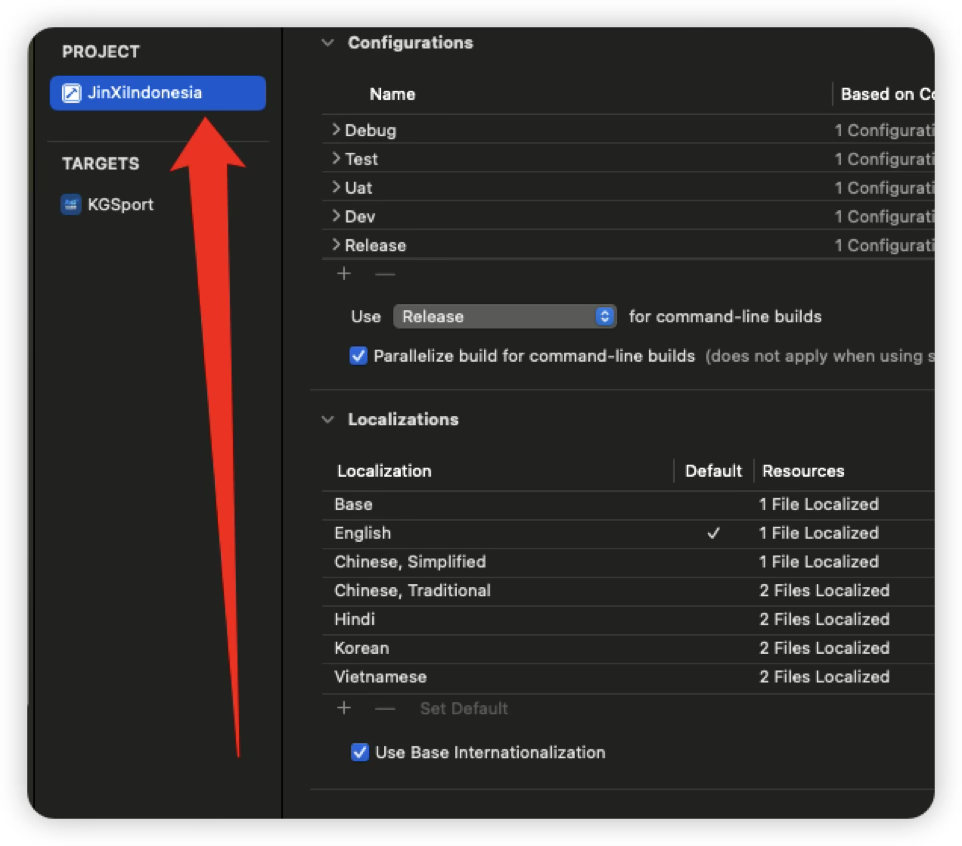
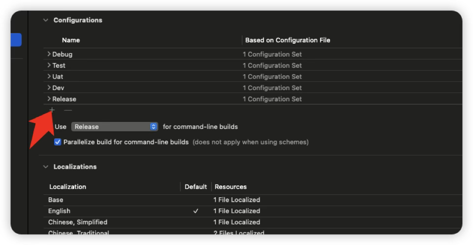
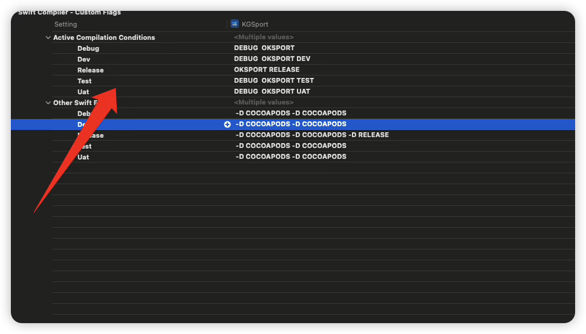
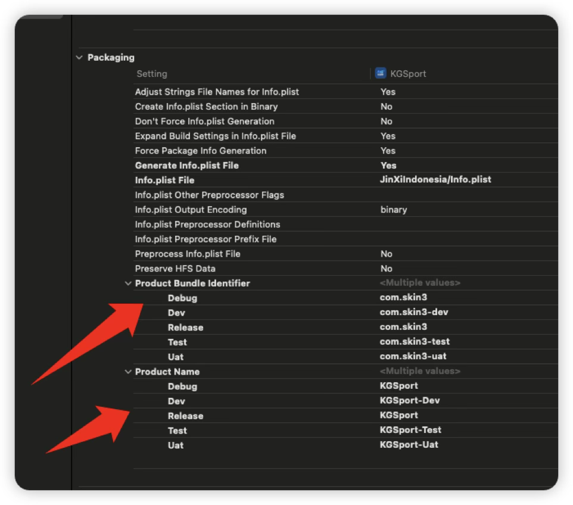

<iframe
  src="https://dragonir.github.io/3d/#/earth"
  title="Jobs出品，必属精品"
  width="100%"
  height="400"
  style="border:0; display:block;"
  allowfullscreen>
</iframe>

<!-- jobs-toc:start -->
<!-- jobs-toc:source {"v":2,"token":"[toc]"} -->
<details>
<summary>📚 目录（点击展开 / 收起）</summary>

- [一、打开项目并找到 🔼](#jobs-toc-heading-1)
- [三、代码中使用 🔼](#jobs-toc-heading-2)
- [四、配置 Podfile 🔼](#jobs-toc-heading-3)
- [五、如果需要安装多个app包 🔼](#jobs-toc-heading-4)

</details>
<!-- jobs-toc:end -->

## <span id="jobs-toc-heading-1" data-jobs-toc="v2">一、打开项目并找到 <a href="#iOS项目多环境配置" style="font-size:17px; color:green;"><b>🔼</b></a> <a href="#🔚" style="font-size:17px; color:green;"><b>🔽</b></a> <a href="#前言" style="font-size:17px; color:green;"><b>🔼</b></a></span><!-- jobs-toc:heading-end -->

<table>
  <tr>
    <td></td>
    <td></td>
  </tr>
</table>

* 找到`build setting` 👉搜索 `Swift Compiler - Custom Floags` 。这里就是第一步添加的环境，然后在里面添加宏定义变量

  

## <span id="jobs-toc-heading-2" data-jobs-toc="v2">三、代码中使用 <a href="#iOS项目多环境配置" style="font-size:17px; color:green;"><b>🔼</b></a> <a href="#🔚" style="font-size:17px; color:green;"><b>🔽</b></a> <a href="#前言" style="font-size:17px; color:green;"><b>🔼</b></a></span><!-- jobs-toc:heading-end -->

> 一定要先判断自定义的宏定义，在判断系统的**`debug`**和**`release`**，系统的宏优先级更高，所以会每次都进入系统宏的条件中

```swift
import UIKit

open class PYBaseUrl: NSObject {}
extension PYBaseUrl {
    #if DEV
    //MARK: 开发环境
    public static var base_dev = "https://XXX"
    #elseif TEST
    //MARK: 测试环境
    public static var base_dev = "https://XXX"
    #elseif UAT
    //MARK: UAT环境
    public static var base_dev = "https://XXX"
    #else
        #if DEBUG
        //MARK: 测试环境
        public static var base_dev = "https://XXX"
        #else
        // 生产环境的正式域名
        public static var base_dev = "https://XXX"
        #endif
    #endif
}
```

## <span id="jobs-toc-heading-3" data-jobs-toc="v2">四、配置 `Podfile` <a href="#iOS项目多环境配置" style="font-size:17px; color:green;"><b>🔼</b></a> <a href="#🔚" style="font-size:17px; color:green;"><b>🔽</b></a> <a href="#前言" style="font-size:17px; color:green;"><b>🔼</b></a></span><!-- jobs-toc:heading-end -->

> 修改对接的环境： 然后`pod install`一次

```ruby
# 👇 新增：指定 Xcode 项目文件和配置映射（特别重要）
project 'JinXiIndonesia.xcodeproj',
  'Debug'   => :debug,
  'Release' => :release,
  'Uat'     => :debug,
  'Dev'     => :debug,
  'Test'    => :debug
```

## <span id="jobs-toc-heading-4" data-jobs-toc="v2">五、如果需要安装多个app包 <a href="#iOS项目多环境配置" style="font-size:17px; color:green;"><b>🔼</b></a> <a href="#🔚" style="font-size:17px; color:green;"><b>🔽</b></a> <a href="#前言" style="font-size:17px; color:green;"><b>🔼</b></a></span><!-- jobs-toc:heading-end -->



<a id="🔚" href="#iOS项目多环境配置" style="font-size:17px; color:green; font-weight:bold;">我是有底线的👉点我回到首页</a>
