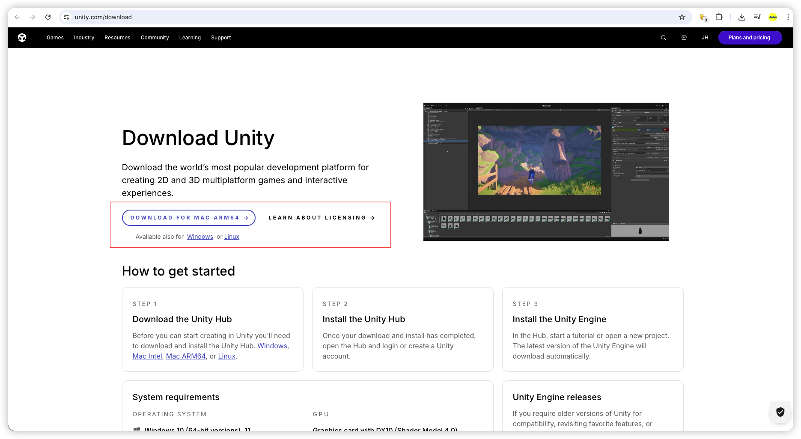
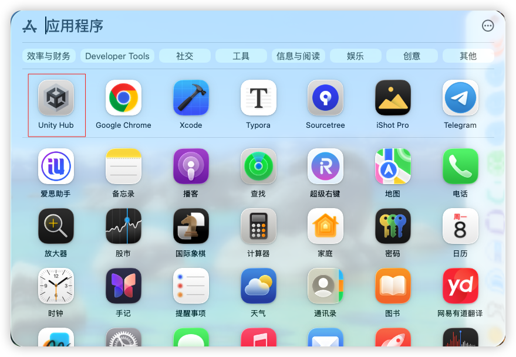
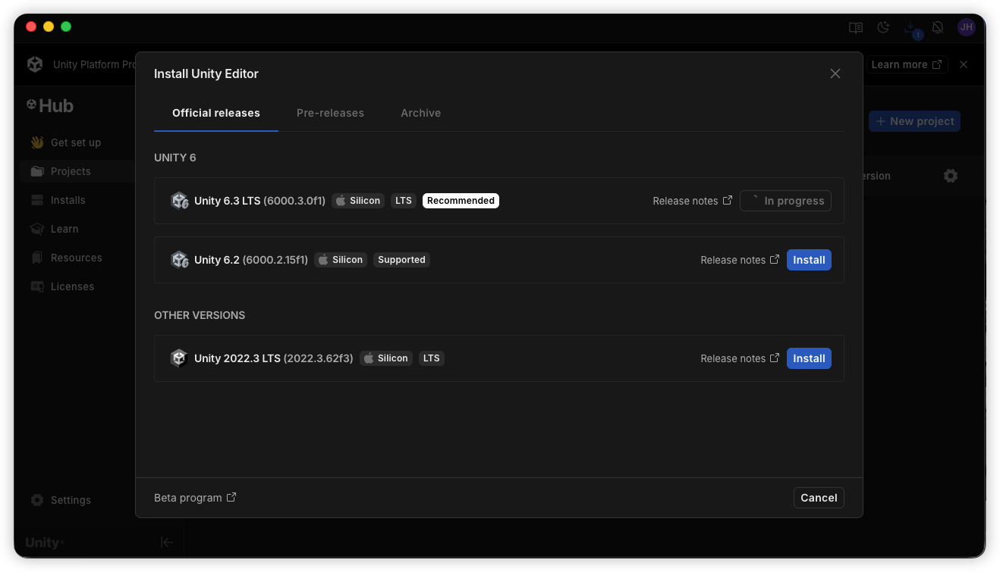
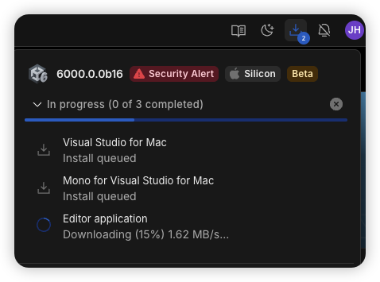
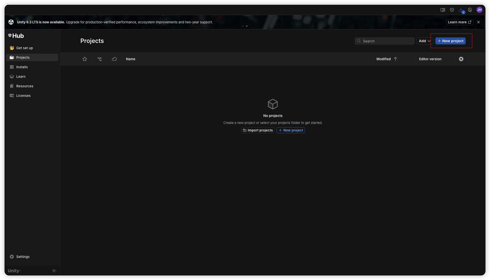
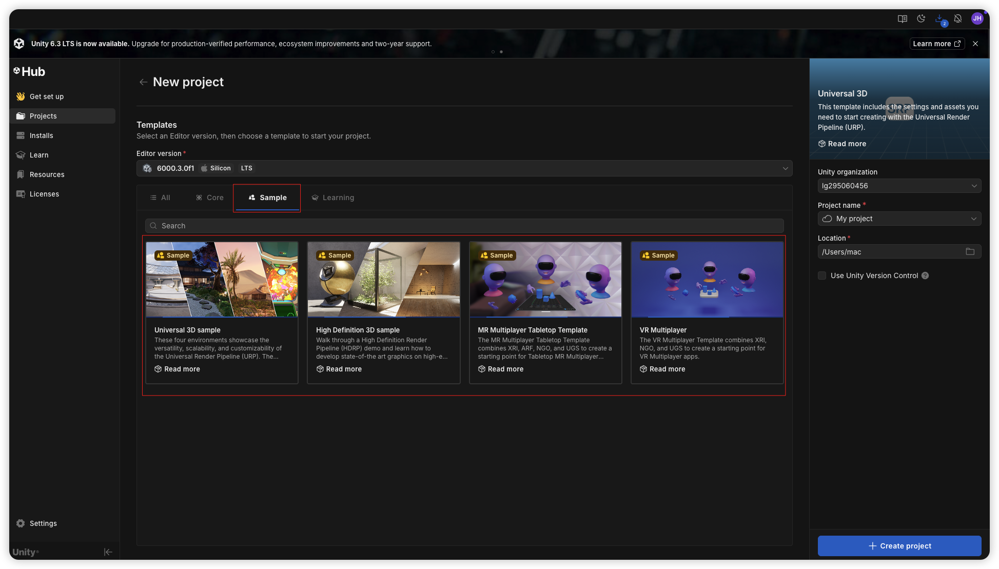
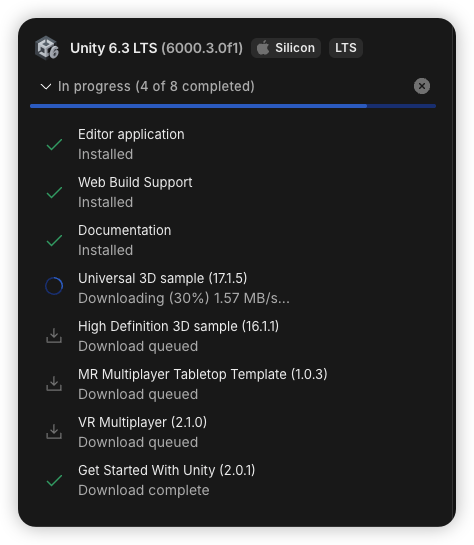

<iframe
  src="https://dragonir.github.io/3d/#/earth"
  title="Jobs出品，必属精品"
  width="100%"
  height="400"
  style="border:0; display:block;"
  allowfullscreen>
</iframe>

<!-- jobs-toc:start -->
<!-- jobs-toc:source {"v":2,"token":"[toc]"} -->

📚 目录（点击展开 / 收起）

- [一、准备工作](#jobs-toc-heading-1)
  - [1、下载安装Unity Hub](#jobs-toc-heading-2)
  - [2、运行Unity Hub](#jobs-toc-heading-3)
  - [3、下载SDK](#jobs-toc-heading-4)
  - [4、下载编辑器](#jobs-toc-heading-5)
- [二、使用](#jobs-toc-heading-6)

<!-- jobs-toc:end -->

## 一、准备工作 <a href="#前言" style="font-size:17px; color:green;"><b>🔼</b></a> <a href="#🔚" style="font-size:17px; color:green;"><b>🔽</b></a><!-- jobs-toc:heading-end -->

### 1、下载安装[**Unity Hub**](https://unity.com/download) <a href="#前言" style="font-size:17px; color:green;"><b>🔼</b></a> <a href="#🔚" style="font-size:17px; color:green;"><b>🔽</b></a><!-- jobs-toc:heading-end -->

### 2、运行[**Unity Hub**](https://unity.com/download) <a href="#前言" style="font-size:17px; color:green;"><b>🔼</b></a> <a href="#🔚" style="font-size:17px; color:green;"><b>🔽</b></a><!-- jobs-toc:heading-end -->

* 需要注册并登陆账户

### 3、下载SDK <a href="#前言" style="font-size:17px; color:green;"><b>🔼</b></a> <a href="#🔚" style="font-size:17px; color:green;"><b>🔽</b></a><!-- jobs-toc:heading-end -->

### 4、下载编辑器 <a href="#前言" style="font-size:17px; color:green;"><b>🔼</b></a> <a href="#🔚" style="font-size:17px; color:green;"><b>🔽</b></a><!-- jobs-toc:heading-end -->

## 二、使用 <a href="#前言" style="font-size:17px; color:green;"><b>🔼</b></a> <a href="#🔚" style="font-size:17px; color:green;"><b>🔽</b></a><!-- jobs-toc:heading-end -->

* 来自于[**Unity Hub**](https://unity.com/download)的演示资源

  * 新建工程

    

  * 下载演示资源
  
    <table style="width:100%; table-layout:fixed;">
      <tr>
        <td>
          
        </td>
        <td>
          
        </td>
      </tr>
    </table>

* 现成的资源（一般用于开发和测试）。相当一部分社区的案例是不支持模拟器的
  * [**Unity 官方的 UAAL 示例**](https://github.com/Unity-Technologies/uaal-example)
  * [**别人已经搞好的 Swift Demo**](https://github.com/superbderrick/UnitySwift)
  
* 需要首先利用[**Unity Hub**](https://unity.com/download)将Unity资源导出至iOS平台所需要的`*.framework`

  * `Unity-iPhone.xcodeproj`
  * 以及一个 `UnityFramework.framework`（在它的 Products 里）

* 框架导入：`#include <UnityFramework/UnityFramework.h>`

<a id="🔚" href="#前言" style="font-size:17px; color:green; font-weight:bold;">我是有底线的➤点我回到首页</a>
