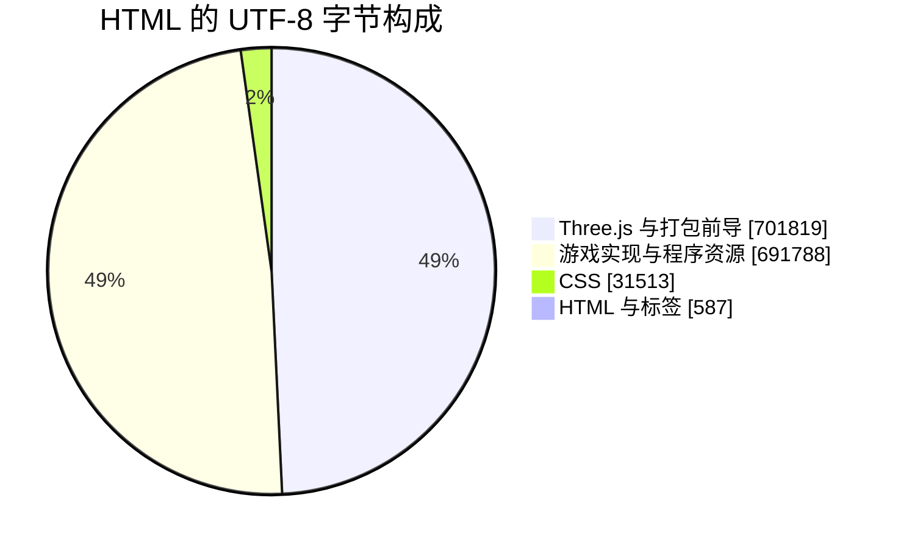
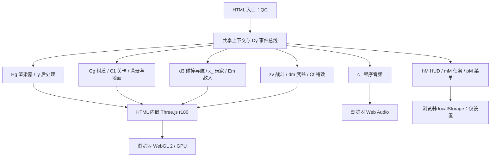
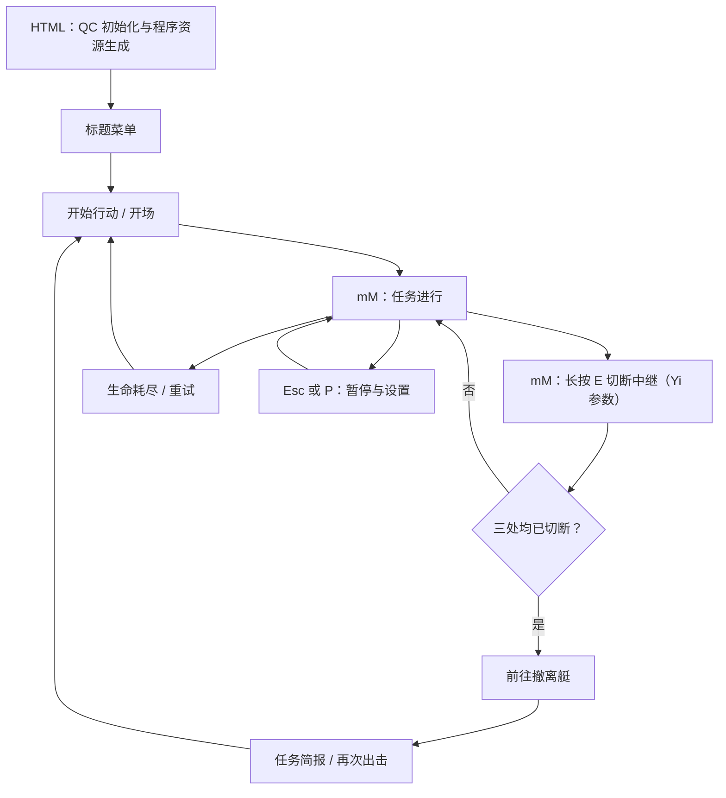

# 几猫国产 3A 大作 V1 · 单文件游戏解析


<!-- jobs-toc:start -->
<!-- jobs-toc:source {"v":2,"token":"[toc]"} -->
<details>
<summary>📚 目录（点击展开 / 收起）</summary>

- [🔥 前言](#%E5%89%8D%E8%A8%80)
- [一、当前能做什么](#features)
- [二、1 MB 左右为什么能装下这些效果](#size-dependencies)
  - [2.1、文件体积拆分](#size)
  - [2.2、到底有没有联网拉依赖](#network)
  - [2.3、真正省体积的是“资源配方”](#procedural)
- [三、画面效果怎样叠出来](#rendering)
- [四、代码地图与模块关系](#architecture)
- [五、如何运行与操作](#run)
  - [5.1、启动方式](#launch)
  - [5.2、真实操作入口](#controls)
  - [5.3、画质与常见问题](#quality)
- [六、源码已有的调试参数](#debug)
- [七、工程边界与验证范围](#scope-verification)

</details>
<!-- jobs-toc:end -->

---

## 🔥 <span id="前言">前言</span>

[游戏入口](./几猫国产3A大作_V1.html)是一个雨天港区题材的浏览器第一人称射击演示，包含可游玩的任务、程序化场景、枪械、敌人、音效和完整菜单。

**它没有在运行时拉取一大堆依赖。明确识别到的核心第三方库是内嵌的 [**Three.js**](https://threejs.org/) r180，约占文件一半；另一半主要是游戏实现、着色器和资源生成逻辑。视觉效果来自程序生成与实时渲染的组合。**

当前交付形态是单文件演示成品，未附原始构建工程，维护状态和作者身份待确认。“3A 大作”是文件与页面名称，不能据此认定具有商业 3A 游戏的内容量。页面关于生成模型的介绍属于页面自述，文件本身无法验证生成过程。

## 一、<span id="features">当前能做什么</span> <a href="#前言" style="font-size:17px; color:green;"><b>🔼</b></a> <a href="#🔚" style="font-size:17px; color:green;"><b>🔽</b></a>

| 能力 | 实现与边界 |
| --- | --- |
| 单人任务 | 在堆场、仓库、码头切断三处中继，随后登艇撤离；每处需要靠近并朝向目标，持续交互约 2.4 秒 |
| 第一人称战斗 | 移动、冲刺、蹲伏、跳跃、瞄准、射击、换弹；弹匣 30 发、备弹 150 发，含后坐力和受击反馈 |
| 敌人与增援 | 机械飞鸥和机械猎犬，具有巡逻、感知、追击、攻击及分波增援逻辑 |
| 雨天港区 | 集装箱、仓库、起重机、船只、湿地反射、雨丝、水花、烟雾和弹孔 |
| 菜单与 HUD | 标题、暂停、死亡重试、任务简报、设置、操作说明；罗盘、任务、交互提示、生命与弹药显示 |
| 声音 | 程序合成枪声、脚步、雨风、海浪、机械声、音乐与混响；通过浏览器音频能力播放 |
| 输入 | 键鼠、触屏与标准手柄均有代码路径；本次实际检查以桌面浏览器为主 |
| 画质与设置 | 低／中／高／极高，灵敏度、反转视角、音量、视野和全屏；设置保存在浏览器本地 |
| 调试 | 模块隔离展示、固定相机、性能巡航和效果开关，见[调试参数](#debug) |

**近战存在文案与实现差异：**操作说明列出 `F` 近战，输入层也映射了近战动作，但未找到玩家战斗逻辑消费该输入的完整实现，不能视为已完成的可用功能。

## 二、<span id="size-dependencies">1 MB 左右为什么能装下这些效果</span> <a href="#前言" style="font-size:17px; color:green;"><b>🔼</b></a> <a href="#🔚" style="font-size:17px; color:green;"><b>🔽</b></a>

### 2.1、<span id="size">文件体积拆分</span> <a href="#前言" style="font-size:17px; color:green;"><b>🔼</b></a> <a href="#🔚" style="font-size:17px; color:green;"><b>🔽</b></a>

统计日期：2026-11-12。依据为原 HTML 的 UTF-8 实际字节；排除本 README 与 `.codegraph/`。原文件共 **1,425,707 字节，即 1.426 MB／1.360 MiB，6,214 行**。

| 组成 | 字节数 | 占整文件 |
| --- | ---: | ---: |
| Three.js 与打包前导 | 701,819 | 49.23% |
| 游戏实现、着色器、资源生成及封装尾部 | 691,788 | 48.52% |
| CSS 正文 | 31,513 | 2.21% |
| 其余 HTML 与标签 | 587 | 0.04% |
| 合计 | **1,425,707** | **100.00%** |

拆分以第 4191 行 Three.js 渲染器定义结束后、游戏配置 `var oi={min:new W(-40,0,-30)...` 起始处为界。第一项包含打包导出等前导代码，并非纯净上游库的精确体积；第二项也不等同于人工编写业务源码的体积。



这里只有一个混合打包文件，没有随附测试文件、包清单和锁文件。按文件数无法区分业务与依赖；按行数也会被压缩代码和多行着色器严重扭曲，因此采用字节统计，不把 6,214 行当作原始工程规模。

### 2.2、<span id="network">到底有没有联网拉依赖</span> <a href="#前言" style="font-size:17px; color:green;"><b>🔼</b></a> <a href="#🔚" style="font-size:17px; color:green;"><b>🔽</b></a>

- 全文件只有一个内联 `<script>`，没有外部脚本 `src`、样式表链接、外链字体声明或外部图片／音视频标签。
- 唯一明文 HTTP 地址是 `http://www.w3.org/1999/xhtml`，用于创建 DOM 元素的命名空间，不是下载地址。
- `fetch` 出现在内嵌 Three.js 的通用加载器中；游戏实现段未发现实际资源下载调用。**库里有加载器，不等于游戏启动时调用了加载器。**
- 未发现动态 `import()`、XHR、WebSocket、Base64 资源包，以及外部模型、图片和音频资源路径。
- 桌面浏览器离线实测：直接通过 `file://` 打开，标题、设置和游戏画面均正常进入。捕获的请求仅有本地 HTML 文档，资源请求列表为空，页面错误列表为空。

因此，在已检查的启动与游玩路径中，不依赖 CDN、资源服务器或后端。README 顶部封面是文档装饰外链，不属于游戏依赖。

| 依赖 | 版本／来源 | 集成与用途 | 授权与交付情况 |
| --- | --- | --- | --- |
| Three.js | r180，公有上游 [mrdoob/three.js](https://github.com/mrdoob/three.js/tree/r180) | 直接内嵌；场景图、几何、材质、骨骼、光照与渲染 | 上游为 [MIT](https://github.com/mrdoob/three.js/blob/r180/LICENSE)；本文件未附完整许可文字 |
| 浏览器原生能力 | 浏览器自带，无项目锁定版本 | [**WebGL 2**](https://developer.mozilla.org/en-US/docs/Web/API/WebGL2RenderingContext)、Canvas 2D、[**Web Audio**](https://developer.mozilla.org/en-US/docs/Web/API/Web_Audio_API)、输入、全屏和本地存储 | 属于运行环境，不是需要安装的 npm 包 |

这里只确认一个可明确识别的核心直接第三方库，不能从压缩成品还原完整构建依赖树，也不能把 Three.js 自带的几何算法、加载器和工具类重复算成游戏另行安装的依赖。上游许可要求随副本保留版权及许可声明；若要再分发，应补齐该声明并另行确认游戏代码的授权，不能将上游 MIT 许可套用于全部游戏代码。

### 2.3、<span id="procedural">真正省体积的是“资源配方”</span> <a href="#前言" style="font-size:17px; color:green;"><b>🔼</b></a> <a href="#🔚" style="font-size:17px; color:green;"><b>🔽</b></a>

传统资产流程把大量模型、贴图和录音放进文件；这里保存的是生成这些内容的规则，运行时再展开：

| 看见／听见的内容 | 如何生成 | 为什么省体积 |
| --- | --- | --- |
| 集装箱、起重机、船、武器 | 基础几何体、顶点数据、尺寸参数和层级组合 | 重复构件复用代码与几何，不保存逐件模型文件 |
| 金属涂装、锈蚀、划痕、混凝土 | 噪声与 [**GLSL**](https://www.khronos.org/opengl/wiki/Core_Language_(GLSL)) 着色器生成颜色、粗糙度／金属度等数据和法线纹理 | 保存计算规则，代替大批高清图片 |
| 标识、弹孔、枪身涂装 | Canvas 绘制后转纹理，部分打成图集 | 文字与笔画在本机绘制，不需要逐张外部图片 |
| 云层、雨丝、水波、雾和火花 | 噪声、粒子、时间函数与屏幕空间处理 | 少量规则控制大量动态细节 |
| 枪声、脚步、环境声和音乐 | 振荡、噪声、包络、滤波与音符序列生成 PCM 音频缓冲 | 保存合成规则，代替 MP3／WAV 素材 |

**磁盘体积小，不代表运行成本低。**程序生成需要启动计算，生成后的纹理、顶点、音频缓冲和多张渲染目标占用内存与显存；多遍渲染还会持续消耗 GPU。这个演示的有限港区、重复材质和少量敌人，也使其比大型内容工程容易压缩。

## 三、<span id="rendering">画面效果怎样叠出来</span> <a href="#前言" style="font-size:17px; color:green;"><b>🔼</b></a> <a href="#🔚" style="font-size:17px; color:green;"><b>🔽</b></a>

| 视觉层 | 源码中的做法 | 实际边界 |
| --- | --- | --- |
| 材质与照明 | 生成材质纹理、环境光照与曝光，控制湿润、锈蚀和粗糙度 | 材质变化丰富，不代表存在海量独立美术资产 |
| 软阴影 | 修改 Three.js 阴影着色器，搜索遮挡物并按距离改变半影过滤 | 阴影贴图方案，不是全场景光线追踪 |
| 湿地反射 | 镜像相机额外渲染场景，将结果投影到地面，再叠加雨水扰动 | 主要服务平面地面，不等于任意曲面的真实反射 |
| 空间层次 | 环境遮蔽、体积雾／光与远景背景 | 增加接触感和空气透视，画质档位影响开关和精度 |
| 镜头表现 | 泛光、光条、曝光适应、调色、暗角、颗粒、镜头污渍、锐化及可选运动模糊 | 通过后处理统一视觉风格；多个效果需要额外渲染通道 |
| 动态反馈 | 武器弹簧动画、步态、呼吸、后坐力、枪口效果、弹壳与贴花 | 用相机和动画强化射击手感，无需大型动画资源库 |
| 性能控制 | 静态物件合批、粒子／敌人池、纹理缓存、动态分辨率和画质降级 | 降低重复创建与绘制成本，仍取决于设备和浏览器 |

这套组合在构图、材质、光照、天气和镜头语言上形成了统一效果，值得研究。源码同时显示它是单关卡单机演示，未包含大型开放世界、多人同步、海量剧情和完整资产生产工具链。

## 四、<span id="architecture">代码地图与模块关系</span> <a href="#前言" style="font-size:17px; color:green;"><b>🔼</b></a> <a href="#🔚" style="font-size:17px; color:green;"><b>🔽</b></a>

已先调用现有 [**CodeGraph**](https://github.com/colbymchenry/codegraph) 的 `codegraph_explore`，返回 `This project has nothing indexed`。因此，下列关系来自原 HTML 的直接核验，没有将空索引当作代码地图结论，也没有重建索引。安装工具与项目已有可查询索引是两件事；具体为空的原因本次未追查。

原始文件经过压缩，单行可能包含很多函数。下表是定位起点，建议同时搜索函数名；这些并非独立源码文件。

| 职责 | 原函数／对象 | HTML 原始行号 |
| --- | --- | ---: |
| Three.js 导出与版本 | `lt`、`REVISION`、`window.__THREE__` | 360、399 |
| 画质、随机数、事件、几何合批 | `Pr`、`zy`、`il`、`Dy`、`By` | 4191 |
| 噪声、天空与软阴影 | `Oy`、`qy` | 4206、4296 |
| 后处理、渲染器 | `jy`、`Hg` | 4743–4744 |
| 材质生成、碰撞导航、关卡 | `Gg`、`d3`、`C1` | 5453 |
| 港区背景、反射、地面 | `Eb`／`pv`、`zb`、`O1` | 5474、5661、5825 |
| 特效、音频、玩家、命中计算 | `Cf`、`c_`／`u_`、`x_`、`zv` | 5939 |
| 武器、敌人 | `dm`、`Em` | 6065–6087 |
| HUD、设置、菜单 | `hM`、`YC`／`Wf`、`pM` | 6087、6110 |
| 任务参数、流程、启动与主循环 | `Yi`（参数）、`mM`、`QC` | 6202 |

以下图表使用可编辑的 [**Mermaid**](https://mermaid.js.org) 源码。所有游戏模块均位于 `几猫国产3A大作_V1.html`。





非核心模块初始化异常时，启动器可能提供简化替身继续运行；渲染器失败则停止。**进入画面不等于所有模块都正常。**排查可查看控制台及 `window.__fatal`、`window.__errors`、`window.__ready` 和 `window.__stats()`，不要只看加载条。

## 五、<span id="run">如何运行与操作</span> <a href="#前言" style="font-size:17px; color:green;"><b>🔼</b></a> <a href="#🔚" style="font-size:17px; color:green;"><b>🔽</b></a>

### 5.1、<span id="launch">启动方式</span> <a href="#前言" style="font-size:17px; color:green;"><b>🔼</b></a> <a href="#🔚" style="font-size:17px; color:green;"><b>🔽</b></a>

用支持 WebGL 2、允许图形加速的桌面浏览器打开 HTML 即可，不需要安装项目依赖或执行构建。点击“开始行动”进入游戏，浏览器可能在交互后才允许播放声音或捕获鼠标。

在 [**MacOS**](https://www.apple.com/macos/) 的本目录执行，也可以使用：

```shell
open './几猫国产3A大作_V1.html'
```

若浏览器对本地文件的输入或存储有限制，可以用现有 [**Python**](https://www.python.org) 启动仅本机可访问的静态服务；这只是可选预览工具，不是游戏运行依赖：

```shell
python3 -m http.server 8080 \
  --bind 127.0.0.1 \
  --directory .
```

再打开 [本机游戏入口](http://127.0.0.1:8080/几猫国产3A大作_V1.html)。终端按 `Ctrl+C` 停止服务；没有后端、数据库或开发／生产环境配置要准备。

### 5.2、<span id="controls">真实操作入口</span> <a href="#前言" style="font-size:17px; color:green;"><b>🔼</b></a> <a href="#🔚" style="font-size:17px; color:green;"><b>🔽</b></a>

| 动作 | 键鼠 |
| --- | --- |
| 移动／视角 | `W A S D`／鼠标 |
| 开火／瞄准 | 鼠标左键／右键 |
| 换弹／交互 | `R`／靠近目标长按 `E` |
| 跳跃／冲刺／蹲伏 | `Space`／`Shift`／`C` 或 `Ctrl` |
| 暂停／继续 | `Esc` 或 `P`，暂停菜单中点击继续 |

鼠标捕获不可用时，代码提供鼠标移动及边缘转向回退，并映射方向键／`I J K L` 转向、`Enter` 开火。实际捕获与全屏权限由浏览器处理。

触屏使用左侧摇杆和右侧拖动视角，配有开火、瞄准、换弹、跳跃、交互与暂停按钮；摇杆向前推到阈值可冲刺。标准手柄使用双摇杆、`RT/LT` 开火／瞄准、`A/B/X/Y` 跳／蹲／换弹／交互、`L3` 冲刺、`Start` 暂停；触屏与实体手柄本次未做实机验收。

设置以 `saltline.settings.v1` 写入 `localStorage`，保存画质、灵敏度、反转视角、音量和视野，**不保存任务进度**。默认灵敏度 `1.0`、音量 `80%`、视野 `74°`，可调视野范围 `60°–95°`；浏览器禁用存储时，代码会捕获异常并继续使用当前设置。

### 5.3、<span id="quality">画质与常见问题</span> <a href="#前言" style="font-size:17px; color:green;"><b>🔼</b></a> <a href="#🔚" style="font-size:17px; color:green;"><b>🔽</b></a>

> 下表是源码配置，实际分辨率还受窗口大小、设备像素比、GPU 限制及动态降级影响，不是性能保证。

| 参数 | 低 | 中 | 高 | 极高 |
| --- | ---: | ---: | ---: | ---: |
| 基础分辨率比例 | 0.70 | 0.85 | 1.00 | 1.00 |
| MSAA 采样数 | 0 | 2 | 4 | 4 |
| 阴影贴图边长 | 2048 | 2048 | 4096 | 4096 |
| 材质纹理生成基准 | 512 | 1024 | 1024 | 2048 |
| 体积光步数 | 12 | 16 | 24 | 40 |
| 环境遮蔽 | 关 | 开 | 开 | 开 |
| 平面反射比例 | 0 | 0.5 | 0.5 | 1 |
| 泛光 | 开 | 开 | 开 | 开 |
| 运动模糊 | 关 | 关 | 开 | 开 |
| 雨量系数 | 0.5 | 0.8 | 1 | 1 |

自动检测一般为手机选择低档，部分集显或软件渲染选择中档，其余选择高档。材质基准并不表示每张纹理同尺寸，普通纹理有尺寸限制，重点材质另有规则；慢帧时还可能动态降低分辨率和画质。

- **黑屏／启动失败：**查看页面底部错误与控制台，确认 WebGL 2 可用；缺少 GPU 支持时，小文件体积也无法保证可运行。
- **启动稍慢：**加载提示对应运行时生成材质、场景和声音，不能仅凭进度条判断正在联网下载。
- **画面卡顿：**先在设置选择低档，或使用 `?q=low` 重开；降低分辨率、反射与后处理负担通常比关注 HTML 大小更有效。
- **没有声音：**先点击开始、检查主音量，确认没有 `noaudio` 参数；浏览器音频策略和系统输出仍需分别检查。
- **鼠标没锁定：**点击游戏区域；必要时使用本机静态服务预览。手动释放捕获后可从暂停菜单继续。

## 六、<span id="debug">源码已有的调试参数</span> <a href="#前言" style="font-size:17px; color:green;"><b>🔼</b></a> <a href="#🔚" style="font-size:17px; color:green;"><b>🔽</b></a>

参数附在 HTML 地址后面，例如 `几猫国产3A大作_V1.html?q=low&noaudio=1`；多个参数使用 `&` 连接。

| 参数 | 作用 |
| --- | --- |
| `q=low`／`medium`／`high`／`ultra` | 显式指定画质；不指定时自动选择，并考虑已保存设置 |
| `noaudio=1`、`noweapon=1` | 静音、隐藏武器 |
| `autostart=1` | 跳过标题／开场，直接进入任务 |
| `bench=1` 或 `#bench` | 性能巡航，自动开始、强制静音，显示帧时和渲染统计 |
| `show=mats` | 模块展示；可选 `mats`、`level`、`backdrop`、`ground`、`fx`、`weapon`、`enemies`、`props`、`render` |
| `shot=1` | 构图调试，自动开始、默认使用隐藏的 test 档并关闭动态分辨率；不会保存截图 |
| `cam=x,y,z,lx,ly,lz`、`fov=74` | 固定相机位置、朝向目标与视野 |
| `seed=4207`、`eseed=9001` | 游戏与敌人的随机种子 |
| `post=0`、`ao=0`、`vol=0`、`bloom=0`、`dynres=0` | 分别关闭后处理、环境遮蔽、体积效果、泛光、动态分辨率 |
| `mb=1`、`tex=512`、`wet=1` | 强制运动模糊、指定纹理生成基准、指定湿润度 |

部分标志按“非空字符串”判断，例如 `noaudio=0` 仍会静音；开启时用 `=1`，关闭时移除该参数。不能把所有开关都当作 `0/1` 布尔值，表中显式 `=0` 的效果开关按各自源码处理。

## 七、<span id="scope-verification">工程边界与验证范围</span> <a href="#前言" style="font-size:17px; color:green;"><b>🔼</b></a> <a href="#🔚" style="font-size:17px; color:green;"><b>🔽</b></a>

目录中的游戏交付文件只有 `几猫国产3A大作_V1.html`；`.codegraph/` 是本地分析辅助，不是运行依赖。该目录位于上级文档仓库中，核查时游戏文件尚无该路径的提交历史，不能据父仓的提交数推算游戏开发时间、团队人数或工作量。

- **已核实：**内嵌 Three.js r180；字节构成、网络引用、资源生成、模块关系、菜单、参数与玩法代码。未发现后端接口、业务数据库、联机通道或外部业务系统集成。
- **已运行：**2026-11-12，在本机桌面 Chrome 自动化环境中禁用网络，完成低档启动和默认自动高档的标题、设置、进入任务、移动及点击操作检查；所检查路径无外部资源请求，`__fatal` 与错误列表为空。画面已截图核对。
- **尚未验收：**完整通关、长时间稳定性、实体手柄、触屏真机、其他浏览器、真实声音听感及全屏交互；没有据此给出最低硬件规格或帧率承诺。
- **当前缺项：**原始模块工程、构建脚本、包清单／锁文件、Source Map、原始美术工程、完整授权材料。文件可运行，但无法据此保证完整可复现构建。
- **界面现状：**简体中文、固定暗色；未见多语言和白天／黑夜／跟随系统切换。本次仅分析和补充文档，未改动游戏实现。

原 HTML 的 SHA-256 校验值如下，用于确认分析对象；源码变化后应重新核验对应数字与结论。

```text
9e55b5200b088adaf8e1152da04efc0d3b25e236e6baf2dee96f81e23e084966
```

<a id="🔚" href="#前言" style="font-size:17px; color:green; font-weight:bold;">我是有底线的➤点我回到首页</a>
